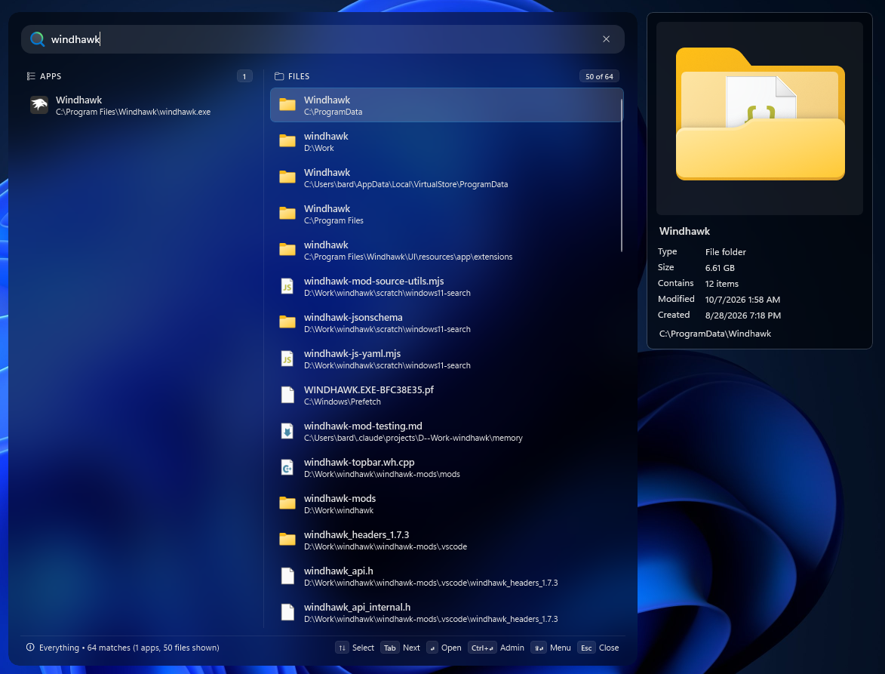
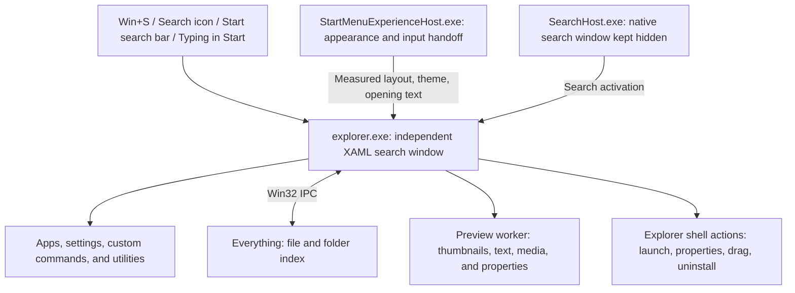

# Everything & Power Tools in the Start Menu

A native replacement for Windows 11 search, powered by voidtools Everything. Press Win+S, click the taskbar search icon, or start typing in Start to search files, apps, and settings in a separate window styled after your Start menu. Windows Search stays out of the way: its window is never shown, and it cannot start the Edge WebView2 process behind its Bing-backed search panel.

Version **2.0** moves search into its own Windows 11 window while keeping Start available as usual.

*Version 2.0: the separate search window with a folder preview.*

---

## Version 2.0 Changes

- Search runs in its own Windows 11 window, opened directly with Win+S, the taskbar search icon, an optional custom shortcut, or by typing in Start. Start itself still opens normally.
- Copies Start's measured size, alignment, background, rounded corners, and supported Start Menu Styler appearance. Root context menus and submenus receive their copied style before appearing.
- Adds app and custom-command suggestions for an empty query, shared favorite learning, configurable menu width and height, and settings organized into sections.
- Adds named custom commands with CMD, Windows PowerShell, PowerShell 7, or a custom shell; optional hidden terminals; and emoji, Windows glyph, image, icon, or executable icons.
- Adds automatic text and monochrome-icon contrast across the search window, with a fixed-color override. Background sampling pauses during motion and scrolling; unchanged samples reuse the cached color map.
- Improves image previews with a built-in Windows decoding fallback. With a bottom taskbar, preview cards grow down while they fit search, then align at its bottom and grow upward when taller. Top and side taskbars keep previews top-aligned and growing downward. Crossing that height and changing selections mid-animation remain smooth.
- Keeps search input and selection when a context menu closes. Typing or Backspace closes the menu and continues the query; Escape closes the menu before clearing search.
- Defers search UI creation until first use, buffers opening text, and restores native and text-box focus after input handoffs.
- Supports top and side taskbars, with animations confined to the selected monitor. Right-side taskbars place the preview on the left.

## Highlights and Key Features

- **Instant voidtools Everything IPC**: Queries Everything directly through its Win32 IPC interface for fast results across millions of files. The mod keeps no index of its own.
- **Smart Apps and Windows Settings Search**: Instant fuzzy matching across Desktop applications, Microsoft Store / UWP packages, Control Panel applets, and Windows Settings URIs (`ms-settings:`), with sharp shell icons, made at the exact pixel size of your display.
- **Learns Your Favorites**: Apps and custom commands you open from here more often move up among results that match equally well. A clearly better match always stays on top. Can be turned off in the settings, which also forgets what was learned.
- **Separate Animated Search Window**: Search follows Start's size, taskbar alignment, colors, and rounded corners, with opening and closing animations that follow the taskbar edge (bottom, top, left, or right) and respect Windows' animation setting. It stays out of the taskbar and Alt+Tab. Typing in Start closes Start and carries the opening text into search. The search bar uses Windows' own search icon.
- **Windows Search Out of the Way**: `SearchHost.exe` keeps running for the shell, but its window is never shown and it cannot launch Edge WebView2, the web view behind its Bing-backed search panel.
- **Search Entry Points**: Open search directly with Win+S, the taskbar search icon, Start’s search bar, or an optional custom shortcut. Pressing Win or clicking Start opens Start normally; begin typing to switch into search.
- **Suggested Apps**: An empty search shows apps and custom commands together, ordered by learned usage when enabled and alphabetically when learning is off. Escape clears the query to suggestions; press it again to close search.
- **Custom Commands**: Add named commands to Apps, choose CMD, Windows PowerShell, PowerShell 7, or a custom shell, and optionally hide the terminal. Icons accept emoji, pasted Windows icon glyphs, Unicode codes, and local image, icon, or app paths. Commands also appear in empty-search suggestions.
- **Optional Files Panel**: Hide the Files panel and pause Everything file queries. With automatic sizing, search becomes half as wide. Apps, settings, custom commands, and utilities remain available.
- **Custom Menu Size**: Set your own menu width and height, or turn the toggle off to follow Start's size. Dimensions follow Windows display scaling and stay within the screen's available area.
- **Inline Calculator**: Type a sum (e.g. `100 * 5`, `sqrt(144)`, `15% of 200`, `2^10`) and the result shows above the apps; large and small results show in scientific notation too (`= 99000`, `= 9.9e4`). Press Enter to copy it.
- **Unit Converter**: Type `100 km` to see it in the usual units of its kind, all on one line first, or `100 km to mi` (also `in`, `->`, `=`) for just one; `255 hex` or `0xFF` for other bases. It knows length, mass, temperature, speed, area, volume, data, data rate, time, pressure, energy, power, angle and frequency, with `.` or `,` as the decimal point, and each kind has its color. A number alone, or one in a name (`2024 report`, `3d`), is left to the search. Add units it does not know in the settings, and have them convert back too (Reciprocal).
- **Network Interface Inspector**: Type `/ip` to display all active Wi-Fi, Ethernet, and VPN network interfaces with their IP addresses, subnet masks, gateways, and hardware descriptions. Press Enter to copy the IP.
- **Full Right-Click Context Menu**: Right-click any file, folder, or application to Open, Run as Administrator, Open in terminal, Properties, Create desktop shortcut, Cut/Copy (files), Copy name (files/folders), Copy path, Open file location, or Uninstall (apps). Escape closes the menu; typing closes it and continues the query.
- **Native Properties Dialogs**: Properties opens through `explorer.exe`, the same dialog as in File Explorer.
- **File Preview**: Images, muted media, PDF pages, SVGs, text/document excerpts, and file properties beside search. The card adapts its alignment and resize direction to the search window’s height. See [File Preview](#file-preview) for formats, copying, and folder sizes.
- **Drag and Drop**: Drag a file or folder into File Explorer, the desktop, or another app. It is always a copy, never a move. Previews stay hidden during the drag. A successful drop closes search; Escape cancels.
- **Uninstall**: Right-click an app and choose Uninstall. After a confirmation that names what goes, a Store app is removed as Start removes it, and a program runs its own uninstaller, the one Installed apps in Settings runs. Protected Windows components offer no uninstall action. A Store app is removed in the background, with no progress bar: it is gone from the list after a few seconds.
- **Opens in Front**: Programs are started by Explorer, the way the stock Start menu starts them, so they come to the front even when they take a while to start or you move the mouse meanwhile.
- **Explicit Web Search**: Trigger web searches on demand using the `?` prefix (e.g. `?query`). Includes customizable keyword shortcuts such as `?yt` (YouTube), `?gh` (GitHub), `?w` (Wikipedia), and `?r` (Reddit).
- **Start Menu Styler Compatibility**: Reads Start's rendered `AcrylicBorder`, search box, and opened context menus from its live visual tree, with a best-effort read of Start Menu Styler's Windhawk registry settings for `WindhawkBlur` parameters and unopened menu rules (not available in portable Windhawk, which falls back to live tree inspection and a glass/acrylic approximation). Automatic text/icon contrast or a fixed text color keeps labels readable; see [Automatic Text and Icon Contrast](#automatic-text-and-icon-contrast).
- **No Simulated Keystrokes**: A low-level keyboard hook (`WH_KEYBOARD_LL`) is active while Start, SearchHost, or the search window is in the foreground to capture opening text and context-menu typing. Focus is handled with standard foreground APIs only; the mod never attaches thread input or synthesizes keystrokes.
- **Accidental Open Prevention**: Enter only triggers actions when an item is selected in the active panel, preventing unintended opening of files.

---

## System Architecture

---

## Custom Commands

In Windhawk, open the mod's **Settings → Custom Commands** and add an entry:

- **Name**: Display name and search term.
- **Icon**: Paste an emoji or a Windows icon glyph, enter a Unicode code such as `E713` (Settings) or `E7E8` (Power), or provide a full path to an image, `.ico`, or executable. `U+E713`, `0xE713`, `\uE713`, and `&#xE713;` also work. Environment variables in paths are expanded. Leave blank for the terminal icon.
- **Shell**: Choose **Command Prompt (CMD)**, **Windows PowerShell**, **PowerShell 7**, or **Custom shell**. Existing commands default to CMD. PowerShell 7 must be installed separately; it is found in its standard installation folder or through PATH.
- **Shell Executable**: For Custom shell, enter its full executable path or a name available in PATH, such as `nu.exe` or `wsl.exe`. Environment variables such as `%ProgramFiles%` are supported.
- **Shell Arguments**: For Custom shell, put `{command}` once as a separate argument where the shell expects the command. The mod quotes it as one Windows argument, preserving quotes, spaces, Unicode and operators inside your code. Do not add quotes around `{command}`. Environment variables in this arguments template are expanded before inserting the command.
- **Hide Terminal**: Run without showing the shell console (default off). Apps opened by the command can still show their own windows, and Run as administrator can still display Windows' permission prompt.
- **Command**: Enter the command for the selected shell. The mod does not guess the shell from the command text. Blank names or commands are ignored. If the selected shell is missing or the Custom shell arguments are invalid, search stays open and shows the reason.

Commands appear alongside installed apps in search results and empty-search suggestions, within **Max App Results**. They share the favorite system: frequently launched entries move up, and equal-use suggestions sort alphabetically. Turning off **Learn Favorite Apps** stops learning and clears history for both apps and commands. Right-click for **Run**, **Run as administrator**, or **Copy command**. Settings changes apply without reopening search. Up to 100 entries are supported.

For example, name a CMD command `Downloads`, use `📂` as its icon, and set its command to `explorer.exe "%USERPROFILE%\Downloads"`. Browse Microsoft's [Segoe Fluent Icons list](https://learn.microsoft.com/en-us/windows/apps/design/iconography/segoe-fluent-icons-font) for Windows glyphs and their codes.

Custom shell examples (the shell must already be installed):

| Shell | Shell Executable | Shell Arguments |
| :--- | :--- | :--- |
| Git Bash | `%ProgramFiles%\Git\bin\bash.exe` | `-c {command}` |
| Nushell | `nu.exe` | `-c {command}` |
| Bash in WSL | `wsl.exe` | `--exec bash -lc {command}` |

Use a full executable path if it is installed somewhere else. WSL requires an installed Linux distribution. PowerShell 7 installation options are described in [Microsoft’s documentation](https://learn.microsoft.com/en-us/powershell/scripting/install/install-powershell-on-windows).

## File Preview

Enable **Settings → Files & Preview → File Preview** to show a card beside the selected file or folder. The card includes its name, type, size, dates, and relevant media or document properties.

With a **bottom taskbar**, the preview uses the available screen space independently of the search window's height:

- **Preview fits inside search's height:** align at the top and resize downward.
- **Preview is taller than search:** align its bottom with search and resize upward, including above the search window.
- **Preview crosses search's height:** switch alignment continuously during the same resize animation, without growing down and jumping up afterward. Rapid selection changes continue from the current size.

The card stays within the monitor's usable area where its height permits. If upward growth reaches the screen's top edge, it uses the available space below.

With a **top, left, or right taskbar**, the preview always aligns with the top of search and resizes downward. A **right taskbar** places the preview on the **left** of search.

| Content | Preview behavior |
| :--- | :--- |
| **PNG, JPEG, BMP, GIF, TIFF** | Shell thumbnails, with Windows' built-in image decoder as a fallback. IrfanView or another image viewer is not required. |
| **SVG** | Rendered using Windows' SVG support. |
| **Video, animated GIF and WebP** | Muted looping playback when **Play Videos and Animations** is enabled. Video format support depends on the codecs available in Windows. |
| **PDF** | Rendered with Windows' PDF engine, without a separate PDF app. With animation enabled, cycle through up to the first ten pages, one per second. |
| **Text and code** | The beginning of the file, with selectable and copyable text. |
| **Word, Excel, PowerPoint, RTF and OpenDocument** | A text excerpt when a supported Windows or Office document filter is available. Text is extracted without document page layout. |
| **Folders** | A folder icon, item counts, and the indexed folder size when enabled in Everything. |
| **PSD and other specialist formats** | A shell thumbnail when a suitable thumbnail provider is installed; otherwise a file icon and available details. Installing an app does not necessarily install a thumbnail provider. |

Click the name, an individual detail value, or the full path to copy it. Copy targets follow the text area, and copying keeps the displayed path unchanged. Select and copy text directly from text/document excerpts. Previews stay hidden throughout drag and drop.

Turn off **Play Videos and Animations** to keep previews still, or turn off **File Preview** to hide the card. Hiding the Files panel also hides its previews and stops the mod's Everything file queries; the Everything application itself keeps running.

## Automatic Text and Icon Contrast

Leave **Settings → Appearance → Text Color** set to **auto** to adapt text and monochrome interface icons to their backgrounds. App and file icons keep their original colors. Enter a color such as **#202020** or **#FFFFFF** to use one fixed text color instead. Windows high contrast takes precedence.

One shared background map covers the search bar, both result panels, headings, and footer. Labels use strong local light or dark tones, and subtitles and hints stay opaque for readability. The map stays aligned while either panel scrolls and is reused as results change. Separate preview and context-menu popups adapt to their own backgrounds.

Background samples refresh up to four times per second while stationary and pause during opening, closing, scrolling, and drag and drop. Unchanged samples reuse the existing map. The menu continues to follow supported Start Menu Styler backgrounds; arbitrary custom effects may not be reproduced exactly.

## Folder Sizes in Preview

To show folder sizes in previews, enable **Index folder size** in Everything:

1. Open **Everything → Tools → Options → Indexes**.
2. Check **Index folder size**, then click **OK**.
3. Let Everything finish updating its index, then select a folder in search with **File Preview** enabled.

The preview reads the indexed size from Everything. Without this option, the folder preview can show an item count but no indexed folder size. Sizes reflect what Everything indexes, so excluded files are not included. See the [Everything folder-size documentation](https://www.voidtools.com/en-us/support/everything/indexes/).

---

## Built-In Commands and Utilities

| Command | Description | Example | Enter Action |
| :--- | :--- | :--- | :--- |
| `<sum>` | Calculation | `100 * 5` `sqrt(144)` `15% of 200` | Copies the result |
| `<number> hex`, `0xFF`, `0b1010` | The number in other bases (digits grouped: `0b111 1111 1111`) | `2047 hex` `0x7FF` | Copies the hex value |
| `<number> <unit>` | The number in the usual units of its kind, all on one line first | `100 km` `32 f` `1,5 kg` | Copies the selected one |
| `<number> <unit> to <unit>` | Just that conversion (also `in`, `->`, `=`) | `100 km to mi` `100 mbps to MB/s` | Copies the result |
| `/ip` | Lists all active Wi-Fi, Ethernet, and VPN adapters with IP, subnet, gateway, and adapter name | `/ip` | Copies selected IP address to clipboard |
| `?<query>` | Searches the web using the default search engine URL | `?weather today` | Opens search in default web browser |
| `?<shortcut> <query>` | Searches specific service using configured shortcut keyword | `?yt lofi hip hop` `?gh windhawk` | Opens query on target service |

---

## Keyboard Shortcuts and Navigation

To add another shortcut, open **Settings → Apps & Search**, turn on **Enable Alternative Shortcut**, and select **Shortcut Modifiers** and **Shortcut Key**. It defaults to **Alt+Space**, disabled. Combine Ctrl, Alt, Shift, and Windows in any combination, or select None for function, media, browser, or special keys. Unmodified typing keys are refused so normal typing cannot be blocked.

The key dropdown includes letters, digits, function, navigation, numpad, punctuation/OEM, browser, and media keys. F12 is reserved by Windows, and Fn/hardware-only keys cannot be registered. Punctuation labels follow a US keyboard layout. Some combinations belong to Windows or other apps; choose another if yours is unavailable. Registration failures appear in the mod log. Changes apply immediately, and Win+S remains available.

| Shortcut / Input | Action |
| :--- | :--- |
| **Win+S / Taskbar search icon** | Open the search window directly |
| **Alternative shortcut (optional)** | Open and focus search using your chosen modifier and key combination |
| **Type in Start** | Close Start and carry the opening text into search |
| **Click Start's search bar** | Open and focus the search window |
| **Up / Down Arrow Keys** | Navigate selection through applications, utility cards, and files |
| **Tab / Shift + Tab** | Move to the next / previous result, through the apps and on into the files |
| **Left / Right Arrow Keys** | Switch between the Apps and Files columns (Right only with the cursor at the end of the query, so the arrows still move the cursor while you edit) |
| **Enter** | Launch selected application, copy calculation/conversion/IP result, or open item. Pressed before the results for what you typed are in, it opens the first one as soon as they arrive |
| **Ctrl + Enter** | Run selected application or file as Administrator (triggers UAC) |
| **Shift + Enter** | Open the selected result's context menu (same as right-click); navigate it with the arrow keys and Enter |
| **Escape** | Close an open context menu first; otherwise clear the query to suggestions, or close search when already empty |
| **Type while a context menu is open** | Close the menu and continue editing the query |
| **Right-Click** | Open the result's context menu |

---

## Right-Click Context Menu Actions

When right-clicking any file, folder, or application:

- **Open**: Opens the file or launches the application.
- **Run as administrator**: Launches executables, scripts (`.bat`, `.cmd`, `.ps1`), shortcuts (`.lnk`), and management consoles (`.msc`) with elevated administrative privileges.
- **Open in terminal**: *(Folders only)* Flyout submenu with options for **Command Prompt** and **PowerShell**:
  - Left-click launches normally in that folder.
  - Right-click launches elevated as Administrator in that folder.
- **Properties**: Displays the native Windows properties dialog sheet for the file, folder, or application via the Explorer Shell Relay host.
- **Open file location**: Opens the parent folder in File Explorer and selects the target item.
- **Copy name**: *(Files and folders)* Copies the name, including the extension for files.
- **Copy path**: Copies the absolute file path as plain text. Keeps search open.
- **Create desktop shortcut**: Creates a `.lnk` shortcut on the Desktop for files, folders, Win32 apps, or Store apps. Existing shortcuts are never overwritten. Keeps search open.
- **Cut**: *(Files panel)* Places the item on the clipboard for a move when pasted into File Explorer or the desktop. Keeps search open.
- **Copy**: *(Files panel)* Places the item on the clipboard for a copy when pasted into File Explorer or the desktop. Keeps search open.
- **Uninstall**: *(Apps panel)* After a confirmation that names what goes, removes a Store app for your account, or runs a program's own uninstaller, the one Settings > Installed apps runs. Not offered for protected Windows components or programs that registered no uninstaller.

> [!NOTE]
> Pinning is not provided by this mod. Use Windows’ own context menu for an app or a desktop shortcut to pin it to Start or the taskbar.

---

## Mod Settings and Customization

Version 2.0 organizes settings into collapsible sections. Windhawk does not transfer preferences from the old flat setting names to these sections automatically. Before upgrading from 1.x, save your settings or note your choices, then reapply them in the new sections after updating. This includes web search shortcuts and excluded path patterns. Custom commands and custom unit conversions keep their existing setting names.

All settings can be customized in the Windhawk UI under **Everything & Power Tools in the Start Menu** > **Settings**:

### Appearance

- **Text Size (%)**: Size of the search panel's text, 80 to 150 percent of the usual (default 100).
- **Text Color**: Enter **auto** for one shared map across the main search window with local light/dark contrast and fully opaque labels, or an optional `#RRGGBB` color override. The map follows scrolling and refreshes up to four times per second while stationary. Applies to text and monochrome interface icons; Windows high contrast takes precedence.
- **Show Keyboard Shortcuts Bar**: Toggle display of the bottom shortcuts hint bar.
- **Use Custom Menu Size**: Override Start's dimensions with **Menu Width** and **Menu Height** (default off). Both default to 660 pixels at 100% display scaling. Width accepts 320–3840 and height 240–2160; larger values are limited to the available screen area. Changes apply immediately. The width is the actual menu width even when Files is hidden; the preview has its own space.

### Apps & Search

- **Max App Results**: Number of application matches displayed in the Apps column (default 6).
- **Learn Favorite Apps**: Rank apps and custom commands you open more often first among equally good matches (default on). Turning it off stops counting and forgets learned usage for both; turn it on again to start over.
- **Search Debounce Delay (ms)**: Extra delay before searching, to let typing settle (default 0, instant). Rarely needed: while a search runs, new keystrokes already wait and only the latest text is searched.
- **Enable Alternative Shortcut**: Add a global shortcut for opening search (default off). Choose its modifier combination and keyboard key in the two dropdowns below. The default selection is Alt+Space; Win+S remains available. Changes apply immediately.

### Files & Preview

- **Hide Files Panel**: Remove the Files column and pause file queries (default off). Automatic sizing also halves the window's width; custom sizing keeps the width you chose. This does not stop the Everything application.
- **Max File Results**: Number of file matches displayed in the Files column (default 12).
- **File Preview**: Show the preview card beside search for the selected file or folder (default on). Click its name, detail values, or path to copy them; text excerpts also support selecting and copying text. With a bottom taskbar, shorter previews align at the top and taller previews align with search’s bottom, with a smooth transition. Top and side taskbars always keep previews top-aligned; a right taskbar puts the preview on the left.
- **Play Videos and Animations**: In the preview, play videos and animated GIF and WebP images, muted and on a loop, and turn through a PDF's first pages, a second each (default on).
- **Filter Noisy Paths**: Hide deep build caches, version control internals, and temporary directories from file results, unless nothing else matches.
- **Excluded Path Patterns**: Paths containing any of these substrings (e.g. `\node_modules\`, `\.git\`, `\build\intermediates\`, `\windows\winsxs\`) are treated the same way, so build artifacts and internal system files do not clutter results.

### Web Search

- **Default Search Engine URL**: URL template for web search queries (default DuckDuckGo: `https://duckduckgo.com/?q={q}`).
- **Web Search Shortcuts**: Define custom prefix keywords and target URLs (e.g. `yt` for YouTube, `gh` for GitHub, `w` for Wikipedia, `r` for Reddit).

### Custom Commands

Add up to 100 named commands with their own icon, shell, and terminal visibility. See [Custom Commands](#custom-commands).

### Custom Unit Conversions

Add units the converter does not know already. Formulas use `x` as the input number (e.g. `x / 16` for px to em). **Reciprocal** also converts back for a linear formula (`a * x + b`). Add, edit, or remove individual conversions at any time.

---

## How It Works Internally

### Search Window and Startup

Explorer hosts an independent Win32 window with a Windows XAML island. The native input relay starts after mod initialization. The XAML UI is created on the first search request, once the taskbar's own XAML island is ready; opening text is buffered until search can receive it. This avoids constructing the UI during early sign-in. Only the Explorer process that owns the taskbar creates search.

Start publishes measured layout and supported appearance data through a validated IPC bridge. Search follows that layout and copies the background, search box, colors, corners, and menu presentation. Context-menu styles are prepared before root menus and submenus open. The native SearchHost window stays hidden, and its WebView2-backed search view is blocked.

### Search Providers

Apps and Windows Settings are matched locally. File queries go directly to Everything's Win32 IPC window, including named instances of Everything 1.5. The mod maintains no file index. Hiding the Files panel stops its file queries and file navigation. Custom commands are loaded from settings and run only when selected.

### Preview and Shell Actions

A preview worker fetches shell thumbnails and properties, renders PDFs with Windows.Data.Pdf, reads text excerpts, and queries Everything for folder facts. SVGs use XAML's SvgImageSource; videos use a muted MediaPlayerElement. Available document filters provide document text. Preview work stays off the search UI thread. Folder sizes come from Everything's index; the mod does not recursively scan a folder to calculate its size.

Applications launch through Explorer's desktop ShellExecute interface so they can come to the foreground. The Explorer helper also handles native property dialogs, shell drag-and-drop with copy-only effects, and validated Store package removal requests. Desktop programs use their registered uninstallers.

Ordinary hidden custom commands use a process created without a console. Visible commands use the selected shell through Explorer; explicit Run as administrator requests use Windows elevation.

---

## Requirements

1. **Windows 11 (x86-64)**: Tested on **25H2 and 26H2**. Other Windows versions and builds, including Insider builds, have not been verified.
2. **voidtools Everything**: **Everything 1.4** or **Everything 1.5**, including alpha/beta and named instances. Keep the application running in the tray; the service alone is not enough. Download from [voidtools](https://www.voidtools.com/).
3. **Windhawk**: Install [Windhawk](https://windhawk.net/) and load the mod.

---

## Taskbar Search

**Win+S**, the **taskbar search icon**, and **Start’s search bar** open search directly. Pressing **Win** or clicking the **Start button** opens Start normally; begin typing there to switch into this search. The full taskbar search box is not supported, so set Search to **Search icon only** or **Hide**:

1. Right-click an empty area on the Taskbar and select **Taskbar settings** (or navigate to **Settings** > **Personalization** > **Taskbar**).
2. Under **Taskbar items**, set **Search** to **Search icon only** or **Hide**.

---

## Troubleshooting and Compatibility

- **Everything is reported as not running:** start the Everything application and leave it running in the tray. Its service alone does not provide the search IPC window. Everything 1.4 and 1.5 alpha/beta, including named instances, are supported.
- **A preview shows only an icon:** enable File Preview. Common image formats have a built-in decoding fallback; specialist formats may require a thumbnail provider, and videos may require a compatible Windows codec. Unavailable or unreadable content falls back to its icon and available properties.
- **Folder sizes are missing:** enable Everything's **Index folder size** option; see [Folder Sizes in Preview](#folder-sizes-in-preview). The mod does not recursively scan folders to calculate sizes.
- **Start Menu Styler appearance is not copied yet:** open Start so its layout and live visual tree can be measured (and open a context menu in Start if using portable Windhawk so its live menu presenter can be captured). Reading `WindhawkBlur` parameters and unopened menu rules from Windhawk's registry is best-effort and does not work with portable Windhawk.
- **A custom command does not start:** choose the shell that understands the command. PowerShell 7 and custom shells must already be installed. Hide Terminal hides the shell console; it does not shorten the command's lifetime or hide windows opened by the command.

Tested on **Windows 11 25H2 and 26H2, x86-64**. Other Windows versions and builds, including Insider builds, have not been verified. For a reproducible problem, include the full Windows build, mod version, Everything version and instance name, other Start/search mods, and steps to reproduce it.

## Building Version 2.0

Open [start-everything.wh.cpp](start-everything.wh.cpp) in Windhawk’s mod editor and compile it. Its metadata declares the compiler libraries, x86-64 architecture, and three target processes: explorer.exe, StartMenuExperienceHost.exe, and SearchHost.exe. Update the existing local mod when testing successive builds.

The older build_and_deploy.ps1 script targets the previous layout and rewrites local settings. Use Windhawk’s mod editor for version 2.0.

---

## License

This project is licensed under the **GNU General Public License v3.0** (GPL-3.0). See [LICENSE](LICENSE) for details.
